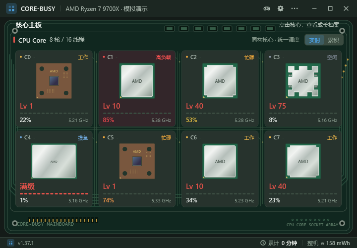
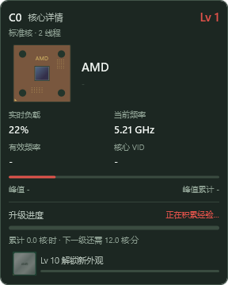

# CORE-BUSY 核忙

> 看看你的 CPU：谁在爆肝，谁在摸鱼，谁在偷偷升级。

把逐核 CPU 监视做成养成游戏：背景是一块 PCB 主板，每颗物理核拥有独立的处理器成长卡，按实际 P/E、CCD 分区；窗口够宽时扩展到 6／8 列，卡片保持可读尺寸，更多核心纵向滚动。
负载就是喂食——核越忙经验越多，攒够就升级、进化。

**[v1.37.1](https://github.com/FiveDayZ/core-busy/releases/tag/v1.37.1)**：修复进程与游戏电源策略的恢复，收紧主界面、设置页和详情弹窗。默认主界面为 720×500 DIP，设置页为 600×560 DIP。

以下为 v1.37.1 的实际 WPF 界面，使用模拟拓扑与等级展示布局和成长造型。



## 玩法

| 功能 | 说明 |
| --- | --- |
| 芯片角色卡 | 根据真实 CPU 厂商走 Intel / AMD 两条路线，各五种 2000 年之后的处理器封装；保留等级、性格、EXP 与逐核监控 |
| 喂食 = 负载 | 保留占用率与当前频率；增高窗口可查看 SMT 线程明细；实时 / 累积两种口径 |
| 经验动画 | 点芯片弹出角色卡：以封装展示、实时状态和成长进度分区，保留 EXP 动画与升级预估 |
| 性格角色 | 摸鱼 / 闲时热手 / 稳态 / 苦劳 / 尖峰 / 夜猫，按负载形状与昼夜分布判定 |
| 外观进化 | Lv 10 / 40 / 75 / 99 更换处理器主体；详情预告下一形态，运行中跨阶段播放一次短动画；高负载警示独立于硬件造型 |
| 状态栏 | 显卡 → 内存 → 硬盘 │ 累计运行时间（悬浮看本次 / 上次）│ 累计整机能耗（估算，带 ≈） |
| 性能优化 | 进程亲和性 / CPU 与 I/O 优先级规则；游戏电源策略联动；应用后回读、失败回滚、退出恢复原值 |
| 常驻与省电 | 托盘常驻；性能模式；主题跟随 CPU 厂商；设置内一键开机启动 |

点击芯片弹出的角色卡（EXP 动画条 + 「距升级约 X」预估）：



**经验口径**：占用 ≥ 15% 按负荷积分，5%~15% 陪伴兜底（×0.15），< 5% 摸鱼不给经验。
每个采样区间先取奖励再累加，不叠加负载与兜底。等级 1–99，账本落盘跨进程延续。
以每天运行 8 小时、单核平均占用约 30% 为基准，约 365 天满级；未运行或纯空闲不累计。
等级只表示「这颗核陪你跑了多久」，已有经验保留并按新曲线映射。

## 下载与运行

从 [Releases](https://github.com/FiveDayZ/core-busy/releases) 下载 `CoreBusy-v{版本}-win-x64.zip`，
解压双击 `CoreBusy.App.exe` —— 完整版单文件自包含，无需安装 .NET 运行时。
精简版文件名带 `-lite`，需要 .NET 8 Windows Desktop Runtime x64。

> 管理员身份运行才能读温度 / 功耗 / 风扇；读不到就是 `-`，绝不拿 0 冒充。

## 数据与配置

数据在 `%APPDATA%\CORE-BUSY\`（标题栏「更多」按钮可直达）：
`core-exp.json`（经验）· `core-roles.json`（角色）· `runtime.json`（运行时长）·
`energy-history.json`（能耗账本）· `settings.json`（配置，含整机能耗分项系数）。

无 UI 的调试环境变量：`COREBUSY_MOCK_CPU`（模拟拓扑）、`COREBUSY_FORCE_BRAND`（锁品牌主题）、
`COREBUSY_CORE_VIEW=cumulative`（累积视图启动）、`COREBUSY_DATA_DIR`（重定向数据目录）。

## 构建

```bash
python scripts/setup-dotnet-sdk.py   # 恢复 .NET SDK 8.0.425
python scripts/build-release.py      # 构建 → 单文件发布 → 打包
python scripts/lint_ui.py            # XAML 结构 + 绑定静态检查
```

发布产物见 `dist/`：full（自包含，约 159 MB）/ lite（4.9 MB，需系统 .NET 8 桌面运行时）。
EXP 曲线推导见 [docs/EXP-DESIGN.md](docs/EXP-DESIGN.md)。

回归检查（Python / Node 检查跨平台，WPF 与拓扑检查需要 Windows 和 .NET 8 SDK）：

```bash
python -m unittest discover -s tests -p 'test_*.py' -v
node --test tests/dashboard.test.cjs
dotnet run --project tests/CoreBusy.RegressionTests -c Release
```

WPF 窗口与设置保存流程可加 `-- --ui <截图目录>` 验证。测试使用独立数据目录，
不连接用户遥测后台；CI 自动执行静态、后台 HTTP、看板转义和 Windows 回归检查。
真实浏览器集成检查：`python tests/browser_smoke.py --browser <Chromium路径> --output <证据目录>`。

## 许可证

本项目基于 [MIT License](LICENSE) 开源。
